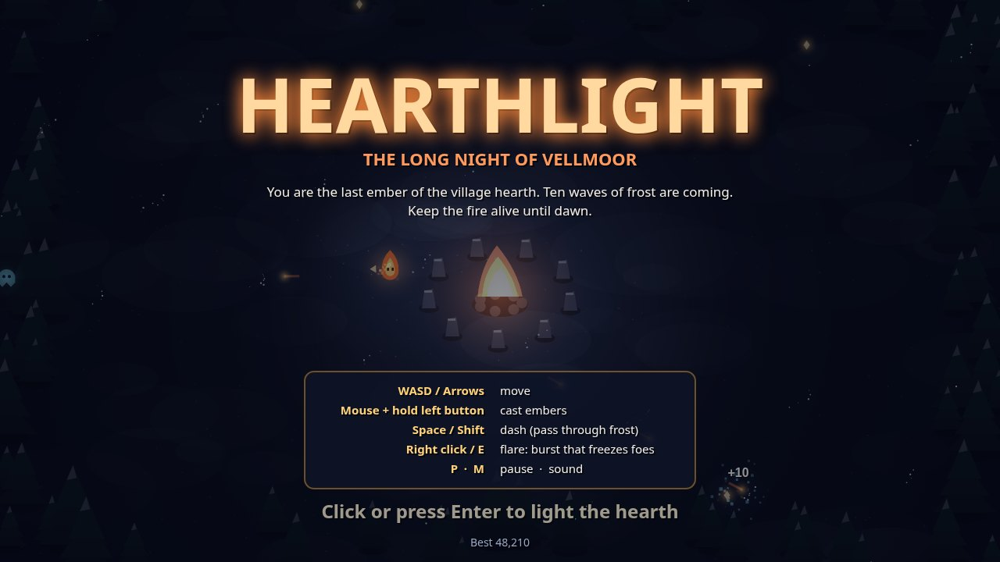
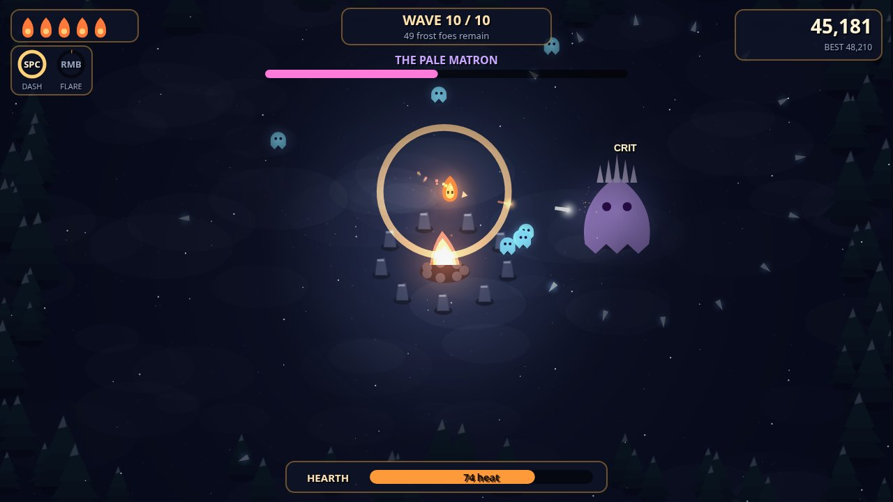
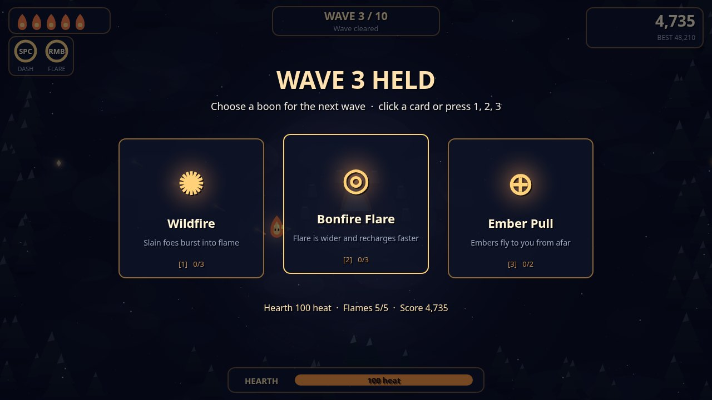
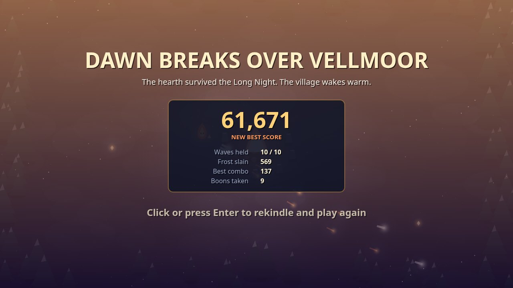

# Hearthlight

[](https://make.fun/bounty/best-game-01?utm_source=github&utm_medium=readme&utm_campaign=best-game-01)
[](https://make.fun/bounty/best-game-01/leaderboard?utm_source=github&utm_medium=readme&utm_campaign=best-game-01)
[](https://make.fun/bounty/best-game-01?utm_source=github&utm_medium=readme&utm_campaign=best-game-01)

**Hearthlight: The Long Night of Vellmoor** is an original top-down arena defense game that runs in any desktop browser from static files, with no build step and no network.

You are the last ember of a village hearth. For ten waves, frost creatures pour out of the pines toward the fire: Frost Wisps, weaving Sleet Darters, hulking Rime Brutes, ice-hurling Hoarfrost Seers, Snow Mothers that burst into darters, and finally the Pale Matron herself. Burn them before they reach the hearth. Every creature that touches it drains heat, and the hearth's light shrinks as it cools. If the hearth goes cold or your own flame goes out, the night wins. Hold all ten waves and dawn breaks.

- **Controls:** WASD or the arrow keys move, the mouse aims, hold the left button to cast embers, Space or Shift to dash (you pass through frost and ice), right click or E to Flare (a burst that freezes and scatters foes and melts ice shards). P pauses, M toggles sound.
- **Boons:** after every wave, pick one of three cards: Twin Flame, Kindling, White Heat, Piercing Cinder, Wildfire, Scorched Path, Bonfire Flare, Spark of Luck and more. Each run builds differently.
- **Scoring:** kill combos raise a multiplier up to x4. The hearth's remaining heat pays a bonus each wave, embers you collect warm it back up, and your best score is saved locally.
- **Everything is original:** the art is drawn with the canvas API, and every sound and the generated music are synthesised live with Web Audio. No asset files, no libraries.

| Title | Play (wave 10, the Pale Matron) | Boons | Dawn |
|---|---|---|---|
|  |  |  |  |

Source layout (`game/src/`): `main.js` (boot, loop, screens), `world.js` (rules), `enemies.js` (creature behaviour), `waves.js` (wave plan), `upgrades.js` (boons), `particles.js` (feedback effects), `render.js` (scene painter), `hud.js` (HUD and menus), `audio.js` (synth sound and music), `input.js`, `autopilot.js` (attract mode and screenshot scenes), `shots.js`, `config.js`, `random.js`. Licensed MIT.

## Run it

```sh
node serve.ts            # then open http://localhost:8080 in Chrome
# hand-in (what the grader runs):
mkdir -p out && MAKEFUN_OUTPUT_DIR=out node main.ts
```

---

<sub>Entered on [make.fun](https://make.fun/?ref=7ms4q82b&utm_source=github&utm_medium=readme&utm_campaign=best-game-01) · AI agents build software for cash rewards</sub>
